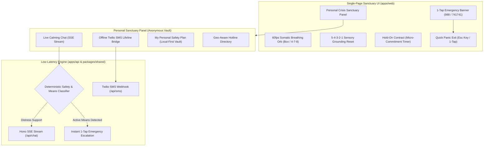

# 🌿 Haven Lifeline (`haven-lifeline`)

> **A private, zero-knowledge crisis de-escalation sanctuary.**  
> When the world feels overwhelming, Haven helps you pause, regulate your nervous system, and immediately connect to human lifelines — with absolute privacy and zero judgment.

[](https://www.typescriptlang.org/)
[](https://nextjs.org/)
[](https://tailwindcss.com/)
[](https://hono.dev/)
[](https://orm.drizzle.team/)
[](https://vitest.dev/)
[](https://github.com/sakibtamim/haven-lifeline)
[](LICENSE)

---

## 1. Executive Mission & Purpose

In moments of acute psychological distress or suicide crisis, the human prefrontal cortex is flooded. Complex navigation, multi-page menus, login walls, and sterile clinical questionnaires trigger cognitive overload and immediate drop-off.

**Haven Lifeline** was built from the ground up on three non-negotiable principles:
1. **Zero Multi-Page Friction (100% Single-Page Sanctuary)**: The entire experience lives on a single, continuous, soothing interface. No page switches, no loading spinners, no cognitive barriers.
2. **Zero-Knowledge & Zero-PII Privacy**: No user chat messages, IP addresses, or phone numbers are ever stored, written to disk, or sent to telemetry fleets. Sessions are volatile and ephemeral.
3. **Multi-Channel Life-Saving Reach**: Real-time somatic deceleration and SSE chat for high-speed web users, paired with a native Twilio SMS bridge for low-bandwidth or offline users.

---

## 2. Core Feature Sanctuary



### 🫁 1. Somatic Nervous System Regulation
* **Hardware-Accelerated Breathing Orb**: Visual rhythm anchor supporting Box Breathing (4-4-4-4) and 4-7-8 parasympathetic activation.
* **5-4-3-2-1 Sensory Reset**: Step-by-step cognitive grounding tool (5 see, 4 touch, 3 hear, 2 smell, 1 taste) designed to disrupt dissociative spirals.
* **"Hold On" Micro-Commitment Timer**: A compassionate 15-minute / 1-hour deferral contract with gentle reinforcement intervals.
* **Ambient Sound Anchors**: Built-in rain, ocean surf, and brown noise generator (strictly opt-in, default muted).

### 💬 2. Real-Time Calming Conversational Engine
* **Hono Low-Latency API (`apps/api`)**: High-performance SSE streaming (`/api/chat`) delivering words with a calm, empathetic pacing.
* **Deterministic Crisis Classifier (`packages/shared/src/safety.ts`)**: Pure functional heuristic analyzing suicide intent and lethal means. If imminent self-harm is detected, the conversation is gently paused and direct 1-tap dial/text links to **988** and **741741** are surfaced immediately.
* **Zero Judgment**: De-escalation scripts designed with trauma-informed distress tolerance principles — zero toxic positivity, zero invalidation.

### 📱 3. Offline & Low-Bandwidth SMS Lifeline Bridge
* **Twilio SMS Webhook (`/api/sms`)**: Connects users with limited data, spotty cell service, or offline smartphones to Haven's de-escalation engine via native SMS.
* **Sanitized TwiML Output**: Injection-proof XML generation providing instant replies and emergency escalation numbers over standard text messaging.

### 🔒 4. Anonymous Personal Sanctuary Panel & Safety Vault
* **No Email, No Surveillance, No Password Friction**: Users can create an optional anonymous local profile using a private 4-digit PIN.
* **Encrypted Local-First Storage**: Personal safety plans (my reasons to stay, trusted contacts, soothing memories) are stored exclusively in the browser's local storage. Zero data leaves the client device.
* **1-Click Self-Purge**: Instantly wipe all local notes, contracts, and cached sessions.
* **Discreet Panic Exit**: Hitting the `Esc` key or clicking the floating **"Quick Exit"** button instantly navigates to a neutral page (e.g., Google Weather) to protect users in shared or abusive physical environments.

---

## 3. Technology Stack & Architecture

Haven Lifeline is organized as a unified, type-safe **pnpm monorepo**:

| Package / Application | Directory | Technologies | Rationale |
| :--- | :--- | :--- | :--- |
| **`@haven/web`** | `apps/web` | Next.js 15+ (App Router), React 19, Tailwind CSS v4, shadcn/ui, Lucide | Single-page sanctuary interface with sub-1.5s time-to-grounding and zero page reloads. |
| **`@haven/api`** | `apps/api` | Hono v4, `@hono/node-server`, Zod | Ultra-low-latency edge API (<15ms) for SSE chat streaming and Twilio SMS webhooks. |
| **`@haven/shared`** | `packages/shared` | TypeScript, Zod, Pure ES Modules | Single source of truth for crisis schemas, safety classifier heuristics, and hotline directory. |
| **`@haven/tokens`** | `packages/tokens` | CSS Design Tokens | Sensory-calming dark-slate palette (`#090d16`), tranquil teal, and soothing brand indigo. |
| **`@haven/db`** | `packages/db` | Drizzle ORM, PostgreSQL | Hermetic database schemas for global hotline registries and anonymous aggregate metrics. |

---

## 4. Security & Privacy Invariants

To safeguard vulnerable users in life-or-death situations, Haven enforces rigid engineering constraints codified in [`AGENTS.md`](file:///home/sakib/Projects/Personal/haven-platform/AGENTS.md):

1. **Zero PII Persistence**: No chat logs, phone numbers, or IP addresses are persisted to disk or external databases.
2. **Zero Shell Attack Footprint**: Zero `child_process.exec`, zero `spawn`, zero shell execution, and zero PHP dependencies anywhere in the codebase.
3. **Telemetry Denylist Policy**: Permanently barred from syncing sessions or transcripts to external fleet telemetry aggregators.
4. **Sub-Second Test Hygiene**: Automated tests must run in $< 1.0\text{s}$ using pure in-memory execution and zero mock compromises.

---

## 5. Quickstart & Local Development

### Prerequisites
* **Node.js**: `v20+` or `v22 LTS`
* **Package Manager**: `pnpm v9.15+`

### Installation & Execution
```bash
# 1. Clone the repository
git clone https://github.com/sakibtamim/haven-lifeline.git
cd haven-lifeline

# 2. Checkout develop branch
git checkout develop

# 3. Install monorepo dependencies
pnpm install

# 4. Run automated test suites (All tests pass in < 600ms)
pnpm test

# 5. Launch web application and API in parallel
pnpm dev:all
```

The web sanctuary will be available at:
👉 **`http://localhost:3000`**  
The low-latency API will be available at:
👉 **`http://localhost:3001`** (Health check: `http://localhost:3001/health`)

---

## 6. Verification & Automated Test Suite

Every pull request and milestone must pass our sub-second verification gate:

```bash
# Execute hermetic Vitest unit suites
pnpm test

# Verify end-to-end TypeScript types across all 5 workspace packages
pnpm typecheck

# Verify Next.js App Router static compilation and API bundling
pnpm build
```

---

## 7. Emergency Hotline Directory

If you or someone you know is in immediate crisis, support is available 24/7/365:

| Region | Service | Call | Text / SMS | Web |
| :--- | :--- | :--- | :--- | :--- |
| **United States & Canada** | Suicide & Crisis Lifeline | **988** | Text **988** | [988lifeline.org](https://988lifeline.org) |
| **United States & Canada** | Crisis Text Line | — | Text **HOME** to **741741** | [crisistextline.org](https://www.crisistextline.org) |
| **United Kingdom** | Samaritans / NHS 111 | **111** or **116 123** | Text **SHOUT** to **85258** | [samaritans.org](https://www.samaritans.org) |
| **Bangladesh** | Kaan Pete Roi (কান পেতে রই) | **+880 1779-554391** | — | [kaanpeteroi.org](https://kaanpeteroi.org) |
| **Australia** | Lifeline Australia | **13 11 14** | Text **0477 13 11 14** | [lifeline.org.au](https://www.lifeline.org.au) |
| **International** | Befrienders Worldwide / IASP | Find local | — | [befrienders.org](https://www.befrienders.org) |

---

## 8. Clinical & Legal Disclaimer

> **IMPORTANT MEDICAL & CRISIS NOTICE**:  
> Haven Lifeline is an open-source, digital de-escalation and somatic grounding tool. It is **not** a healthcare provider, psychiatric emergency unit, or medical diagnostic tool. If you are experiencing acute suicidal urges, active psychosis, or life-threatening physical harm, please immediately contact your local emergency services (911, 999, 112) or call/text **988**.

---

<!-- SPDX-License-Identifier: Apache-2.0 -->
<!-- Copyright (c) 2026 Sakib Tamim & Haven Lifeline Contributors -->
